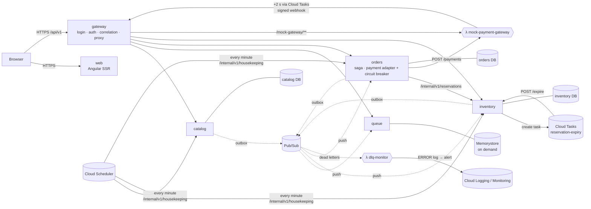
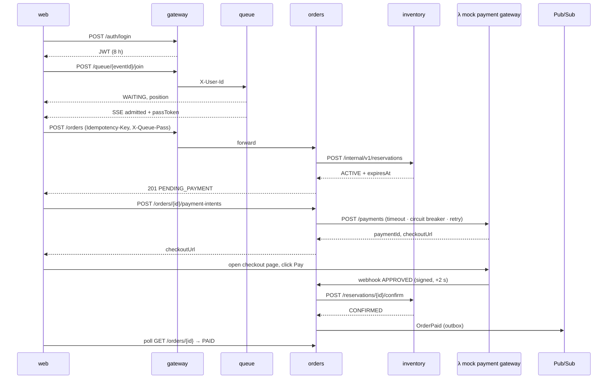

# Architecture overview (prototype slice)

## Components

`λ` = FaaS component (Cloud Run functions). Everything else is a container on Cloud Run.

| Unit | Owns | Store | Public routes (via Gateway) | Spec |
| ---- | ---- | ----- | --------------------------- | ---- |
| `apps/web` | UI | — | serves pages | [README](../../apps/web/README.md) |
| `services/gateway` | session token, correlation ID, routing, quota, CORS | — | `/api/v1/auth/login` | [README](../../services/gateway/README.md) |
| `services/catalog` | events, sectors, sales window, sales rules; decides if a sale is open | Postgres `catalog` | `/api/v1/events/**` (except availability) | [README](../../services/catalog/README.md) |
| `services/queue` | queue order and paced admission, pass | Memorystore for Redis (only for live tests and demos, ADR-0001) | `/api/v1/queue/**` | [README](../../services/queue/README.md) |
| `services/orders` | order, checkout saga, payment adapter | Postgres `orders` | `/api/v1/orders/**`, `/api/v1/payments/webhook` | [README](../../services/orders/README.md) |
| `services/inventory` | availability, reservations | Postgres `inventory` | `/api/v1/events/{id}/availability` | [README](../../services/inventory/README.md) |
| `functions/mock-payment-gateway` | stand-in for the external PSP (FaaS) | Firestore *(optional)* | `/mock-gateway/**` | [README](../../functions/mock-payment-gateway/README.md) |
| `functions/dlq-monitor` | dead-letter alerting (FaaS) | — | — | [README](../../functions/dlq-monitor/README.md) |

The full public routing table is in [`services/gateway/README.md`](../../services/gateway/README.md).

## Happy path

Nothing runs outside a request (ADR-0002): outbox rows are flushed right after each commit,
and Cloud Scheduler calls each Postgres service's housekeeping every minute to flush leftovers
and run sweeps (reservation expiry, pending refunds). The webhook is processed before it is
answered; a failure makes Cloud Tasks retry it.

## Saga branches Orders must handle

| Situation | Result |
| --------- | ------ |
| Inventory rejects the reservation | Order not created; same `code` and HTTP status propagated |
| Webhook `APPROVED`, confirm → `CONFIRMED` | Order `PAID`, `OrderPaid` via outbox in the same transaction |
| Webhook `APPROVED`, confirm → `EXPIRED` (race with expiry) | Order `REFUND_PENDING`, mock refund called with idempotency key; reservation is **not** reactivated |
| Webhook `DECLINED` | Order stays `PENDING_PAYMENT` (the buyer may retry until the reservation expires) |
| `ReservationExpired` received while `PENDING_PAYMENT` | Order `EXPIRED` |
| Duplicate webhook (same notification id) | No-op, 200 |
| Webhook processing fails (e.g. Inventory down) | Non-2xx; Cloud Tasks retries the notification (ADR-0002) |
| Refund call fails | Order stays `REFUND_PENDING`; housekeeping retries the refund |
| Payment gateway times out / circuit open | `503 PAYMENT_UNAVAILABLE`; order stays `PENDING_PAYMENT`; reservation expiry is **not** extended (ADR-03) |

State machines of every lifecycle entity: [state-machines.md](state-machines.md).

## Asynchronous topology

See [`contracts/events/README.md`](../../contracts/events/README.md) for topics, subscriptions,
payload schemas and delivery rules.
