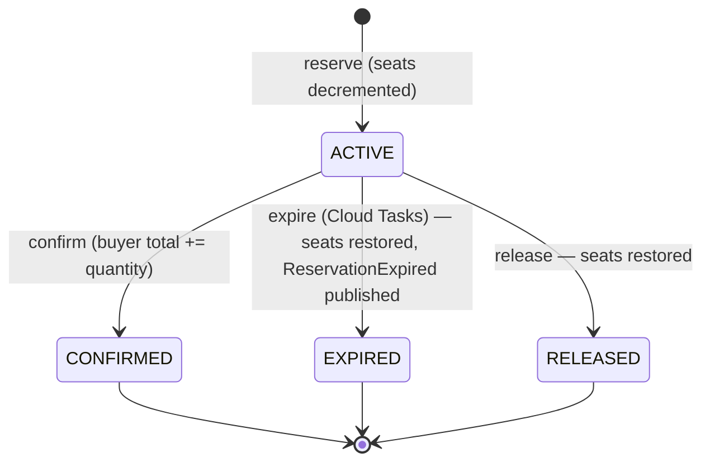
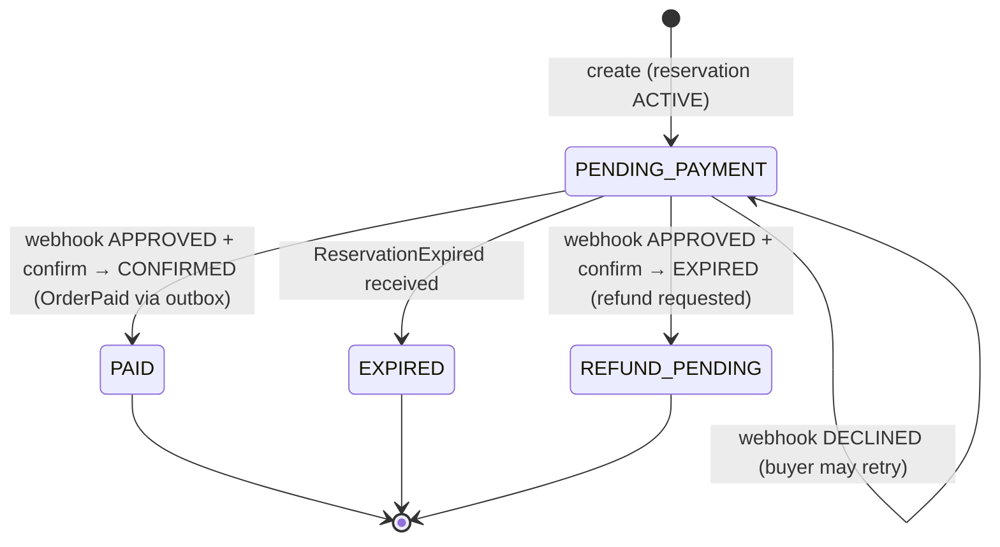
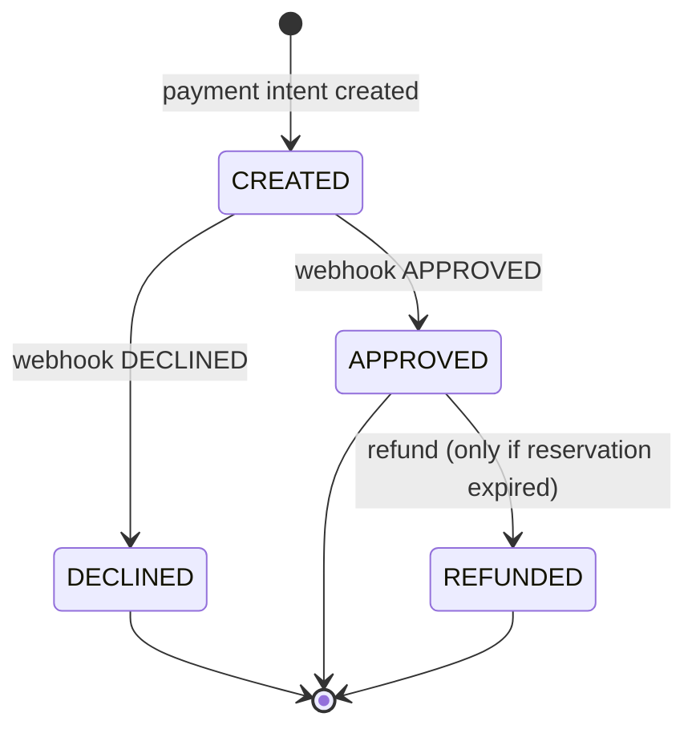
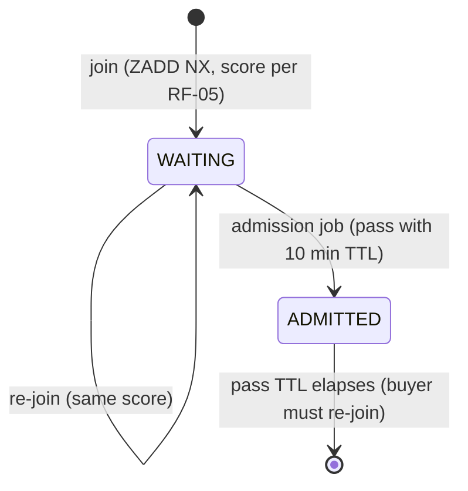
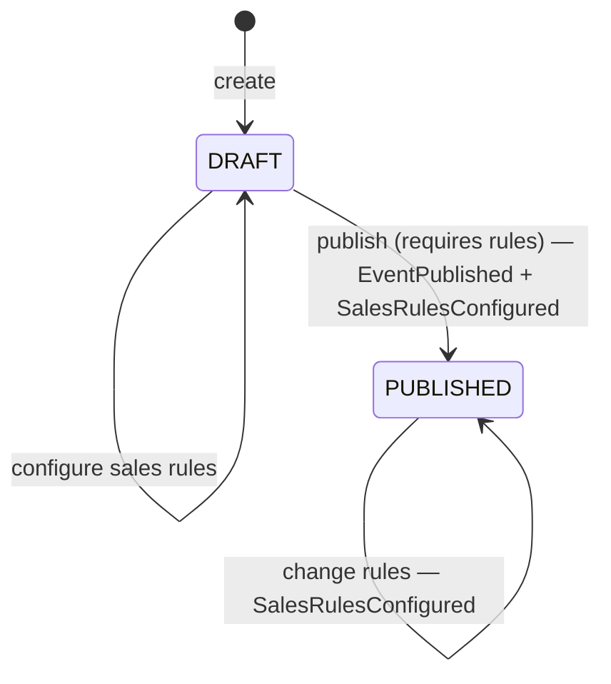

# State machines of lifecycle entities

Normative. Every transition is implemented as a **conditional update** on the current state
(`UPDATE … SET status = :to WHERE id = :id AND status = :from`), so concurrent actors cannot both
win. Any transition not drawn here is a bug. Each service has tests for every arrow.

## Reservation (inventory)

- `confirm` and `expire` race for `ACTIVE`; whoever updates one row wins, the other returns the
  final state. Repeating any transition returns the current state (idempotent).
- `expire` also requires `expires_at <= now()` (Entrega 2 §5.4). It is triggered by Cloud Tasks
  and, as a safety net, by the one-minute housekeeping sweep (ADR-0003).
- Terminal states never change. An expired reservation is **never** reactivated (ADR-03).

## Order (orders)

- No order is created if Inventory rejects the reservation.
- `EXPIRED` + late `APPROVED` webhook: confirm returns `EXPIRED` → the order goes (or stays) in the
  refund path; a refund is requested with an idempotency key. *Owner to define:* whether an order
  already `EXPIRED` moves to `REFUND_PENDING` on a late approval (recommended: yes — money was taken).

## Payment (orders, mirrored by the mock gateway)

A new attempt after `DECLINED` creates a new payment (new `Idempotency-Key` from the UI).

## Queue entry (queue, Redis)

## Event (catalog)

`saleState` (`SCHEDULED` → `OPEN` → `CLOSED`) is not stored: it is derived from the clock.
